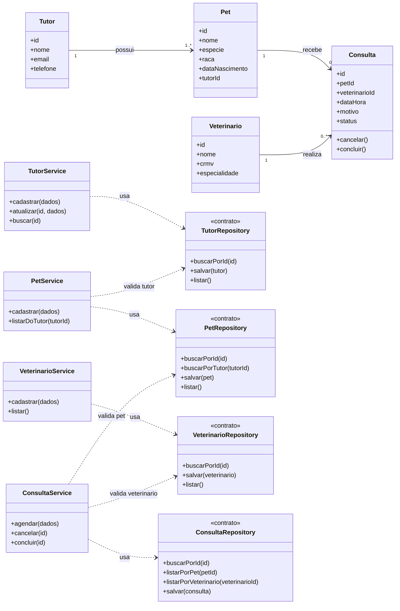

# Modelagem — Projeto 1

**Aluno(a):** Sêneca Brito  
**Domínio:** Gestão de uma clínica veterinária

## 1. O domínio

O sistema organiza o atendimento de uma clínica veterinária, relacionando tutores e seus pets aos profissionais que os atendem. Cada consulta registra o pet, o veterinário responsável, a data e o motivo do atendimento.

## 2. Entidades

| Entidade | Atributos | Relacionamentos |
|---|---|---|
| Tutor | id, nome, email, telefone | possui um ou mais pets |
| Pet | id, nome, especie, raca, dataNascimento, tutorId | pertence a um tutor e pode ter várias consultas |
| Veterinario | id, nome, crmv, especialidade | realiza várias consultas |
| Consulta | id, petId, veterinarioId, dataHora, motivo, status | pertence a um pet e a um veterinário |

## 3. Diagrama de classes

## 4. Responsabilidades

| Entidade | Service (regras) | Repository (dados) |
|---|---|---|
| Tutor | `TutorService` valida e coordena cadastro e atualização dos dados do tutor. | `TutorRepository` busca, lista e salva tutores. |
| Pet | `PetService` verifica se o tutor existe e coordena o cadastro e a consulta dos pets. | `PetRepository` busca, lista e salva pets. |
| Veterinario | `VeterinarioService` coordena cadastro e consulta dos profissionais. | `VeterinarioRepository` busca, lista e salva veterinários. |
| Consulta | `ConsultaService` verifica os vínculos e coordena agendamento, cancelamento e conclusão. | `ConsultaRepository` busca, lista e salva consultas. |

As entidades guardam seus próprios dados e regras simples; nenhuma delas salva a si mesma nem envia comunicação. Cada repository representa um contrato de acesso aos dados, sem definir aqui a tecnologia de armazenamento.

## 5. Onde apliquei SRP e DIP

**SRP:** cada entidade representa um conceito do domínio, cada service cuida das regras de um processo e cada repository cuida do acesso aos dados. Por exemplo, `Consulta` pode controlar suas transições de status, enquanto `ConsultaService` coordena o agendamento e `ConsultaRepository` persiste a consulta.  
**DIP:** os services dependem dos contratos `*Repository`, indicados pelas setas tracejadas no diagrama; não conhecem banco de dados nem tecnologia concreta de armazenamento.

## 6. Fora do escopo (YAGNI)

Login, pagamentos, controle de estoque, prontuário clínico detalhado e relatórios ficam fora do primeiro escopo. O modelo cobre o cadastro das entidades centrais e o ciclo básico das consultas.
